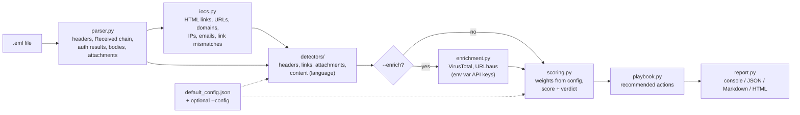

# phish-triage

A SOAR-style command-line tool that triages a suspicious email (`.eml` file) and produces an
analyst-ready verdict, a list of reasons, defanged indicators of compromise (IOCs) and recommended
response actions. It writes JSON for a SIEM/SOAR and a Markdown or HTML report for people.

It is a portfolio/learning project. Every rule and weight is meant to be easy to read and explain.

## The problem

In a Security Operations Centre (SOC), users report suspicious emails all day. Most are harmless,
some are credential phishing, malware delivery or invoice fraud. An analyst checking each one by
hand has to:

1. read the headers (who really sent it? did SPF/DKIM/DMARC pass?),
2. pull out every URL, domain, IP and attachment hash,
3. decide whether it is malicious, and
4. act: block, purge, reset credentials, warn Finance.

Steps 1 to 3 are repetitive and the same every time, so they are a good fit for automation (the
"orchestration and automation" in SOAR). `phish-triage` automates them and recommends step 4, so the
analyst starts from a pre-analysed case instead of a raw email.

## Features

**Header analysis**
- Parses From, Reply-To, Return-Path, Subject, Message-ID, Date and the `Received` chain (shown oldest hop first, with hosts and IPs).
- Reads SPF / DKIM / DMARC results from `Authentication-Results` (falls back to `Received-SPF`). Only the topmost header is trusted by default, and you can restrict it to your own mail server with `trusted_authserv_ids`, because senders can forge these headers.
- Detects a From vs Reply-To domain mismatch (a classic BEC sign) and a From vs Return-Path mismatch (weak signal).
- Detects display-name spoofing: a display name that claims a protected brand ("Maybank2u Security") while the domain is not one of that brand's domains, or a display name that contains a different email address.

**Lookalike domains** (checked against a configurable list of protected brands, by default
`maybank2u.com.my`, `cimbclicks.com.my`, `paypal.com`, `microsoft.com` and related domains)
- IDN/punycode homoglyphs (`xn--mybank2u-16g` is "mаybank2u" with a Cyrillic "а").
- Character substitution (`paypa1`, `rnicrosoft`).
- Typo-squats by Levenshtein edit distance (configurable, default up to 2).
- Brand embedded in another domain (`maybank2u-alerts.example`) or used as a subdomain (`maybank2u.com.my.verify-login.example`).

**IOC extraction**
- URLs (plain text, HTML `href`s and form actions), domains, IPv4 addresses and email addresses.
- Link text vs `href` mismatch (text shows `www.maybank2u.com.my`, link goes elsewhere).
- Raw-IP URLs, URL shorteners, HTML forms and password fields inside the email.
- All IOCs are defanged in reports (`hxxps://evil[.]example`). JSON holds both raw and defanged values.

**Attachments** (held in memory, never written to disk or run)
- MD5, SHA-1 and SHA-256.
- Risky types (`.exe`, `.js`, `.iso`, `.img`, `.html`, `.lnk`, `.one`, macro-enabled Office...).
- Double extensions (`invoice.pdf.exe`).
- Executables detected by file header (`MZ`, ELF) whatever the file name says.
- VBA macros in Office files by simple static inspection: looks for `vbaProject.bin` in the ZIP file list (`.docm`, `.xlsm`) or the `_VBA_PROJECT` marker in legacy OLE files (`.doc`, `.xls`).

**Language heuristics**: urgency ("within 24 hours"), credential harvesting ("verify your account"),
and payment change / BEC ("change of bank details", "wire transfer"). Whole-word matching, lists in the config.

**Scoring**: transparent weighted rules, each listed with its points, giving a verdict of
`likely-phish`, `suspicious` or `likely-benign`. Weights and thresholds live in a JSON config.

**Optional enrichment** (off by default): VirusTotal and URLhaus lookups when API keys are set in
environment variables. Lookups only, never uploads.

**Output**: console summary, JSON, Markdown and HTML reports, plus recommended actions (playbook steps).

## Safety

This tool reads email content as **data only**:

- **It never opens URLs.** No HTTP request is made to any link in the email. The only network calls
  are the optional enrichment lookups to VirusTotal/URLhaus APIs, and only when you pass `--enrich`
  and set API keys.
- **It never executes, opens or extracts attachments.** Attachments stay as bytes in memory. The tool
  hashes them and reads the first bytes and, for Office/ZIP files, only the list of file names inside.
- **HTML is parsed, not rendered.** Python's `html.parser` only tokenises markup, so scripts in the
  email never run.
- **Reports are escaped.** The email is attacker-controlled. HTML reports escape every value, contain
  no clickable links and set a Content-Security-Policy that blocks scripts. Markdown reports put
  attacker values inside code spans. IOCs are defanged.
- **Enrichment is lookup-only.** Uploading a file to VirusTotal makes it available to other
  subscribers and can leak internal data or warn the attacker, so this tool only asks for existing reports.

Still, treat `.eml` files of real phishing as dangerous: don't double-click them in Outlook, and
analyse them in a VM if you can.

## Architecture



| Module | Job |
|---|---|
| `parser.py` | Turns the raw `.eml` into a `ParsedEmail` (stdlib `email` package). Never crashes on malformed input. |
| `iocs.py` | HTML link parsing, IOC extraction, link text vs href comparison. |
| `domains.py` | Registrable domain, punycode decoding, homoglyph "skeleton", edit distance, lookalike check. |
| `detectors/` | One small function per area. Each returns `Finding`s; none of them decides the score. |
| `scoring.py` | Adds up weights for the rules that fired, applies thresholds. |
| `playbook.py` | Maps verdict and fired rules to response actions. |
| `enrichment.py` | Optional VirusTotal / URLhaus lookups with graceful failure. |
| `report.py` | Console, JSON, Markdown and HTML output with escaping and defanging. |
| `analyzer.py` | Runs the steps above in order. |
| `cli.py` | The `phish-triage` command. |

## Quickstart

Requires Python 3.10 or newer. The tool itself only uses the standard library. `pytest` is needed
for the tests and `requests` only for `--enrich`.

### Windows (PowerShell)

```powershell
cd phish-triage
py -m venv .venv
.\.venv\Scripts\Activate.ps1          # if blocked: Set-ExecutionPolicy -ExecutionPolicy RemoteSigned -Scope CurrentUser
pip install -r requirements.txt
pip install -e .

phish-triage analyze .\samples\01_credential_harvest_bank_lookalike.eml
phish-triage analyze .\samples\ --out-dir .\reports --report-format html
python -m pytest
```

### Linux / macOS

```bash
cd phish-triage
python3 -m venv .venv
source .venv/bin/activate
pip install -r requirements.txt
pip install -e .

phish-triage analyze samples/01_credential_harvest_bank_lookalike.eml
phish-triage analyze samples/ --out-dir reports --report-format both
python -m pytest
```

You can also run it without installing the command: `python -m phish_triage analyze file.eml`
(after `pip install -e .`).

### Command reference

```text
phish-triage analyze PATH [--config FILE] [--json] [--out-dir DIR]
                          [--report-format md|html|both] [--enrich] [-q]
```

- `PATH` is one `.eml` file or a folder (batch mode: every `*.eml` in it, then a summary table).
- `--json` prints JSON to stdout instead of the console summary (a list in batch mode), for piping into a SOAR/SIEM.
- `--out-dir` writes `<name>.json` plus a Markdown and/or HTML report for each email.
- `--config` overrides weights, thresholds, brands or keyword lists (see below).
- `--enrich` turns on VirusTotal/URLhaus lookups.

### Getting an email as an .eml file

- **Gmail (web):** open the email, click the three-dot **More** menu next to Reply, choose **Download message**. This saves an `.eml` file.
- **New Outlook for Windows:** select the message, then **More actions > Save as** (or right-click the message > **Save as**). This saves an `.eml` file.
- **Classic Outlook desktop:** *File > Save As* saves Outlook's own `.msg` format, which this tool does not read. Use new Outlook or Gmail, or ask your mail admin for the original message.

Work on a copy, and only analyse real phishing emails you are allowed to handle.

### Optional enrichment

Set the keys as environment variables for the current session only (never put them in code, config
or Git):

```powershell
# PowerShell
$env:VT_API_KEY = "your-virustotal-key"
$env:URLHAUS_AUTH_KEY = "your-abuse.ch-auth-key"
phish-triage analyze .\suspicious.eml --enrich
```

```bash
# Linux
export VT_API_KEY="your-virustotal-key"
export URLHAUS_AUTH_KEY="your-abuse.ch-auth-key"
phish-triage analyze suspicious.eml --enrich
```

If a key is missing, `requests` is not installed, the network is down or the API returns an error,
the result records why (e.g. `"VirusTotal skipped: VT_API_KEY not set."` or `{"status": "error",
"error": "HTTP 429"}`) and the triage continues. At most 4 lookups per service are made per email to
stay inside the VirusTotal free-tier rate limit.

## Sample output

Real output from `phish-triage analyze samples/01_credential_harvest_bank_lookalike.eml`:

```text
======================================================================
File     : samples/01_credential_harvest_bank_lookalike.eml
Subject  : Action required: unusual sign-in to your Maybank2u account
From     : Maybank2u Security <security[@]maybank2u-alerts[.]example>
Reply-To : (none)
Auth     : SPF=softfail  DKIM=none  DMARC=none
VERDICT  : LIKELY-PHISH  (score 100/100)
----------------------------------------------------------------------
Reasons:
  [+35] Lookalike of a protected brand domain
         - maybank2u-alerts[.]example imitates Maybank (maybank2u[.]com[.]my): brand name embedded in domain
         - xn--mybank2u-16g[.]example (decodes to 'mаybank2u[.]example') imitates Maybank (maybank2u[.]com[.]my):...
  [+30] Display name impersonates another sender
         - "Maybank2u Security" claims Maybank but sent from maybank2u-alerts[.]example
  [+25] Link text shows a different domain than the real link
         - shows www[.]maybank2u[.]com[.]my -> goes to hxxp://xn--mybank2u-16g[.]example/m2u/login.php?session=8f3a
  [+15] SPF softfail
         - spf=softfail
  [+15] URL uses a raw IP address instead of a domain
         - hxxp://203[.]0[.]113[.]45/m2u/verify
  [+15] Credential-harvesting language
         - "verify your account"
         - "confirm your identity"
         - "log in to"
         - "unusual sign-in"
  [+10] Urgent / threatening language
         - "within 24 hours"
         - "account will be suspended"
         - "suspended"
         - "action required"
         - "verify now"
  [+ 5] Return-Path domain differs from From domain
         - bounce[@]mail-relay[.]example
----------------------------------------------------------------------
IOCs: 2 URLs, 3 domains, 1 IPs, 2 emails, 0 attachments
  url  hxxp://203[.]0[.]113[.]45/m2u/verify
  url  hxxp://xn--mybank2u-16g[.]example/m2u/login.php?session=8f3a
----------------------------------------------------------------------
Recommended actions:
  1. Block the sender address and sending domain at the email gateway.
  2. Search all mailboxes for the same sender/subject/URLs and purge matching messages (e.g. Microsoft 365 Content Search + Purge, Google Workspace security investigation tool).
  3. Block the listed URL domains/IPs at the web proxy, DNS filter and firewall.
  4. Check proxy/DNS logs for users who visited the URLs. For anyone who clicked or entered credentials: reset password, revoke active sessions/tokens, verify MFA methods and look for new inbox forwarding rules.
  5. Report the impersonation to the impersonated brand's abuse/security team and, if your policy requires it, to MyCERT (Cyber999) in Malaysia.
  6. Record the defanged IOCs in the case/ticket and share them with your threat-intel platform.
======================================================================
```

The raw points add up to 150 and are capped at 100. Notice that the genuine bank URL shown as the
link text (`www.maybank2u.com.my`) is *not* listed as an IOC, so nobody blocks the real bank by mistake.

Batch mode, `phish-triage analyze samples/ -q`:

```text
VERDICT        SCORE  FILE
------------------------------------------------------------
likely-phish     100  01_credential_harvest_bank_lookalike.eml
likely-phish     100  02_malicious_attachment_double_extension.eml
likely-phish      90  03_bec_reply_to_mismatch_invoice.eml
likely-benign      0  04_benign_newsletter.eml
likely-benign      0  05_benign_it_maintenance_notice.eml
```

For the BEC sample the playbook says to block the **Reply-To** address and warn Finance, and
explicitly not to block the From domain without checking, because in BEC that is often a real
supplier being spoofed.

## Sample emails

All samples in `samples/` are synthetic. They use reserved example domains (`example.com`,
`.example`) and documentation IP ranges (`192.0.2.0/24`, `198.51.100.0/24`, `203.0.113.0/24`).
They contain no real people's data. The "executable" and "macro" attachments are harmless
placeholder bytes that only look like those file types to a static check.

| File | Scenario | Expected |
|---|---|---|
| `01_credential_harvest_bank_lookalike.eml` | Fake Maybank2u alert, punycode homoglyph link, raw-IP link | likely-phish |
| `02_malicious_attachment_double_extension.eml` | Overdue invoice with `INV-2026-0193.pdf.exe` and a macro-enabled `.docm` | likely-phish |
| `03_bec_reply_to_mismatch_invoice.eml` | Supplier "change of bank details", Reply-To on another domain | likely-phish |
| `04_benign_newsletter.eml` | Newsletter, all auth passes, links match their text | likely-benign |
| `05_benign_it_maintenance_notice.eml` | Internal IT notice with a PDF attachment | likely-benign |

## How scoring works

1. Each detector reports the rules that fired, with evidence.
2. Each rule's weight is looked up in the config. A rule counts **once** however many times it
   matched (30 bad links are not 30 times worse than 1, and this stops one noisy rule dominating).
3. The weights are summed and capped at 100.
4. Verdict: **>= 60 likely-phish**, **>= 30 suspicious**, otherwise **likely-benign**.

Default weights (`src/phish_triage/default_config.json`):

| Rule | Points | Rule | Points |
|---|---|---|---|
| `lookalike_domain` | 35 | `spf_fail` (fail/softfail/permerror) | 15 |
| `double_extension` | 35 | `dkim_fail` | 15 |
| `executable_content` | 35 | `url_ip_host` | 15 |
| `display_name_spoof` | 30 | `credential_language` | 15 |
| `office_macro` | 30 | `url_shortener` | 10 |
| `dmarc_fail` | 25 | `urgency_language` | 10 |
| `href_text_mismatch` | 25 | `return_path_mismatch` | 5 |
| `risky_attachment_type` | 25 | `auth_results_missing` | 5 |
| `reply_to_mismatch` | 20 | `enrichment_virustotal_malicious` | 40 |
| `payment_change_language` | 20 | `enrichment_urlhaus_listed` | 40 |
| `html_credential_form` | 20 | | |

The weights are judgement calls, not measured values. The idea: technical evidence of deception
(lookalike domains, executables, mismatched links) weighs more than wording, which real companies
also use. You can tune them without touching code:

```json
{
  "weights": { "return_path_mismatch": 0, "urgency_language": 5 },
  "thresholds": { "suspicious": 25 },
  "trusted_authserv_ids": ["mx.yourcompany.example"]
}
```

```bash
phish-triage analyze suspicious.eml --config my_config.json
```

`weights` and `thresholds` are merged key by key with the defaults. Other keys (such as
`protected_brands` or the phrase lists) replace the default value completely.

## Running the tests

```bash
python -m pytest
```

90 tests cover header parsing, every detector, IOC extraction and defanging, lookalike domains,
attachment checks, scoring, report escaping (including an XSS payload), enrichment with a fake HTTP
session (no network), the CLI, and end-to-end runs on every sample. They make no network calls.

## Limitations

- **Heuristics, not proof.** A determined attacker can avoid the keywords, use a clean new domain
  that doesn't resemble a protected brand, and pass SPF/DKIM/DMARC with their own domain.
- **BEC from a compromised real mailbox** passes all authentication and has no lookalike domain. The
  BEC sample scores high partly because SPF/DMARC fail. The same message from a hacked supplier
  account would only get the Reply-To, payment and urgency points (50, "suspicious"), or less if the
  attacker doesn't set a Reply-To.
- **Registrable domain is approximated** with a small built-in list of two-part suffixes (`com.my`,
  `co.uk`...). A full Public Suffix List would be more accurate. Suffixes missing from the list are
  handled wrongly: for `paypay.ne.jp` the tool treats `ne.jp` as the registrable domain, so it
  compares `ne` instead of `paypay`.
- **Lookalike false positives:** short or common brand names can match unrelated domains by edit
  distance (e.g. `paypay.com` is flagged because `paypay` is 1 edit from `paypal`). Mitigated by a
  minimum brand length and per-brand `lookalike_targets`, not eliminated.
- **The homoglyph table is small.** It covers common Cyrillic/Greek letters and digit swaps, not the
  full Unicode confusables list.
- **Macro detection is a simple static check** (file names/markers). It doesn't parse VBA, detect
  XLM/Excel 4.0 macros, or look inside password-protected or nested archives. It doesn't analyse PDFs.
- **Only `.eml` is supported**, not Outlook `.msg`.
- **Keyword lists are English only** by default. Add Bahasa Malaysia phrases in the config for local use.
- **Authentication results are only as trustworthy as the header you trust.** Set
  `trusted_authserv_ids` to your own mail server in real use.
- **Enrichment was only tested with a fake HTTP session** in this project, not against the live
  VirusTotal/URLhaus APIs with real keys.

## Future work

- Read Outlook `.msg` files (e.g. with the `extract-msg` package).
- Use the Public Suffix List and the full Unicode confusables table.
- Deeper attachment analysis with `oletools` (olevba) and PDF JavaScript/link checks.
- Integrations: pull reported emails from a Microsoft 365 / Google Workspace "report phishing"
  mailbox, push JSON into a SIEM, open a ticket (TheHive, Jira).
- Domain age via WHOIS/RDAP (newly registered domains are a strong signal).
- Bahasa Malaysia keyword lists.
- Measure the scoring on a labelled dataset and tune the weights from data.

## License

MIT, see [LICENSE](LICENSE).
